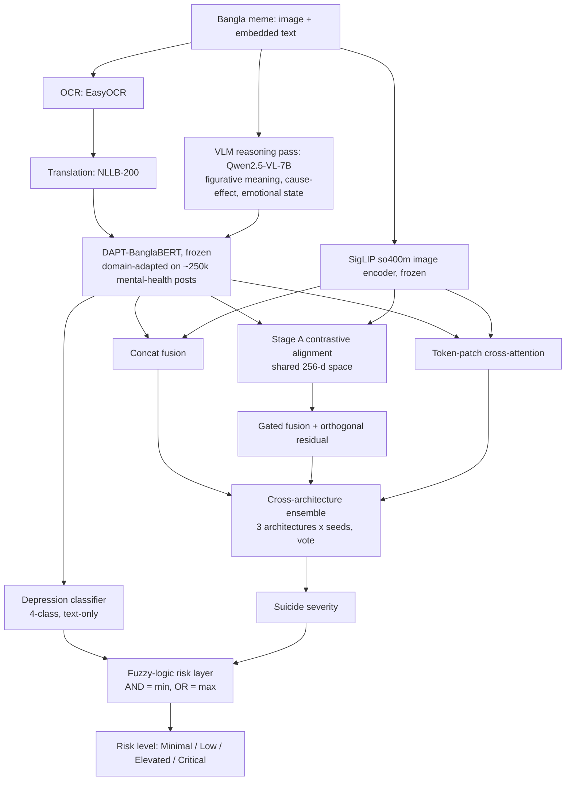
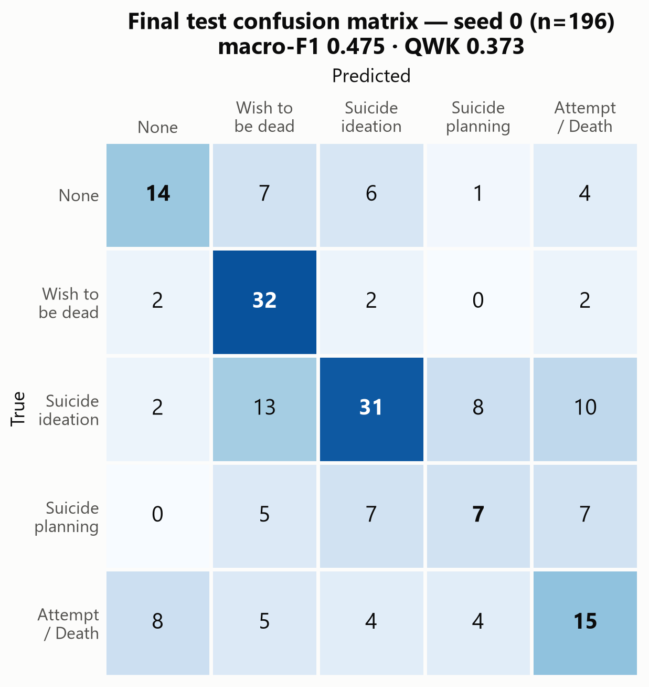

# Multimodal Suicide-Severity Screening for Bangla Memes

Estimating how severe the suicide-related content in a Bangla meme is, from both its image and its embedded text, and combining that with a text-only depression-severity reading into one interpretable risk level.

> **Scope.** This is a screening-support research system. Its outputs describe the *content expressed* in a meme. They are not a clinical judgement about any real person. The risk layer is rule-based and has not been clinically validated.

---

## The problem

Memes are a common way people talk about distress online, often through dark humour, irony and figurative language. In a meme, the meaning usually depends on how the image and the text relate. Text-only models miss this, and Bangla has very little labelled data.

The task is to predict suicide-severity on **FigSIM**, a leakage-safe set of **973 Bangla memes**:
- **5 annotated levels:** None, Wish to be dead, Suicide ideation, Suicide planning, Suicide attempt or death.
- **Harmonized 3-class version:** No expressed severity / Suicidal thought or desire / High-acuity suicidal content.
- **Splits:** 582 train, 195 validation, 196 test.

## Pipeline



Detailed figures:
- [`figures/20_current_verified_pipeline.png`](figures/20_current_verified_pipeline.png): the full system.
- [`figures/09_phase3_architecture.png`](figures/09_phase3_architecture.png): the three fusion architectures.

**Key design decisions**

- **Frozen encoders, small trained heads.** With 582 training memes, every attempt to adapt the large encoders either hurt or was not clearly better (see below).
- **Stage A alignment.** The text and image encoders were trained independently. Without alignment, the gated model's gate collapsed: it ignored text and used the image alone for 71% of memes ([`figures/03_gate_alpha_fix.png`](figures/03_gate_alpha_fix.png)). Contrastive projection into a shared space fixed this.
- **Cross-architecture ensembling.** Concat, gated and cross-attention models make partly independent mistakes, so voting across them beat any single architecture. This was the largest single gain.
- **Two separate severity readings.** Depression and suicide risk are related but clinically distinct. They are combined through an explicit, inspectable fuzzy rule table, never merged into one label space.

## Results

All results below are on the **196 held-out test memes**. The test set was touched only three times in the whole project, and every metric is recomputed from the raw confusion matrices ([`docs/VERIFIED_RESULTS.md`](docs/VERIFIED_RESULTS.md)).

| Model | Task | Accuracy | Macro-F1 | Weighted-F1 | QWK |
|---|---|---|---|---|---|
| Single-model baseline | 5-class | 0.5051 | 0.4753 | 0.4953 | 0.3732 |
| **Cross-architecture ensemble (best)** | **5-class** | **0.5306** | **0.4984** | **0.5232** | **0.3857** |
| Same ensemble, predictions collapsed to 3 classes | 3-class | 0.6582 | 0.6024 | 0.6532 | n/a |
| Native 3-class nine-model ensemble | 3-class | 0.6071 | 0.5730 | 0.6126 | 0.3765 |

For context: on this dataset's original benchmark, fine-tuned fusion models barely beat text-only baselines.

**Depression classifier (text-only, DAPT-BanglaBERT):**
- **Scores:** 0.932 accuracy and 0.918 macro-F1 on its own 4,897-record dataset.
- **Caveat:** the checkpoint was trained on most of this data, so this is a sanity check, not a held-out estimate.
- **Parity:** its wrapper reproduces stored outputs exactly (100% label agreement).

**Cross-validated findings (777 train+val memes, never evaluated on test)**

| Finding | Result |
|---|---|
| Feeding the depression classifier's output distribution into the severity model as features | +0.0129 accuracy, +0.0106 macro-F1 (15-model CV ensemble). The only Phase 9 idea that held up in the full ensemble. |
| Selection optimism from early-stopping on the reported split | Inflates macro-F1 by **+0.040** (0.6155 unbiased vs 0.6557) |
| Learning curve (210 → 527 training examples) | Still rising at **+0.030 accuracy per 100 examples**; data is the binding constraint |



## What didn't work

Every idea was A/B-tested under identical folds and seeds, never bundled with others.

| Idea | Outcome | Why |
|---|---|---|
| CORAL ordinal regression | Worse than cross-entropy | Its single-scalar bottleneck starved the rare classes ([fig](figures/02_coral_vs_ce.png)) |
| Unfreezing the last 2 BanglaBERT layers | −0.026 macro-F1 (validation) | Overfits with 582 examples |
| LoRA fine-tuning of the text encoder | +0.013 macro-F1 on validation only, within noise, not adopted ([fig](figures/13_phase6_lora.png)) | Too little data to adapt large encoders reliably |
| Two-stage hierarchical classifier | Worse | Stage-1 errors cascade into stage 2 ([fig](figures/12_hierarchical_diagnosis.png)) |
| Vision pretraining on an external Bangla meme dataset (BN-HIB) | Learned its own task, did not transfer ([fig](figures/15_bnhib_pretraining_transfer_test.png)) | Domain and label mismatch |
| Swapping in a generic text encoder | −0.073 macro-F1 | Domain-adapted pretraining matters |
| Harmonizing to 3 classes | Not an improvement: −0.029 macro-F1 versus collapsing the 5-class model's predictions | A coarser task looks better on paper but is not better once compared fairly |
| Stacking meta-learner | −0.004 to −0.027 accuracy | Overfits the small combiner set |
| CORN cumulative-link loss | No gain, macro-F1 worse | — |
| Structured figurative-reasoning streams | Significantly worse | Added noise, not signal |
| 300 external "no severity" troll memes as negatives | Class-0 F1 −0.113 | Out-of-domain negatives don't substitute for in-domain data |
| Full-data refit with a fixed epoch count | −0.010 accuracy | Best epoch varies too much between seeds ([fig](figures/22_phase9_final_verdict.png)) |

A pre-registered gate (CV accuracy ≥ 0.72) was set before Phase 9. The best configuration reached 0.687, so the gate failed and **the test set was deliberately not touched again**.

## Limitations

- **Test-set size:** 196 test examples means roughly ±7 points of 95% confidence interval. Results within that range are not separable.
- **Missing modalities:** the severity model has no defined behaviour when an input lacks either the image or the text.
- **Risk layer:** the fuzzy layer is exploratory and has no ground-truth combined-risk label to validate against.
- **Validation split:** Phases 1–8 made decisions on a single 195-example validation split. Cross-validation later measured the resulting optimism.

## Repository layout

```
code/      experiment scripts, named by phase (phase1_* ... phase9_*)
outputs/   aggregate metrics and confusion matrices for each experiment (JSON), results_table.csv
figures/   result and architecture figures
docs/      VERIFIED_RESULTS.md (authoritative numbers), WORKFLOW.md (method description)
```

## Data and reproduction

**No data is included.** The memes and their extracted text are mental-health content, so the following are deliberately excluded: images, OCR text, translations, reasoning outputs, embeddings, model checkpoints and per-meme predictions.

To reproduce:
1. Obtain FigSIM from its authors and place it at `i-h/multimodal_figsim/` (scripts read `data/leakage_safe/figsim_leakage_safe_index.csv`).
2. `pip install -r requirements.txt`. Reasoning steps use a local [Ollama](https://ollama.com) model (`qwen2.5vl:7b`), so no API keys are needed.
3. Run the extraction steps (`run_ocr.py`, `run_translation.py`, `run_reasoning.py`, `extract_*`), then the phase scripts in order.

Main dependencies: PyTorch, Hugging Face Transformers, PEFT, EasyOCR, scikit-learn.
